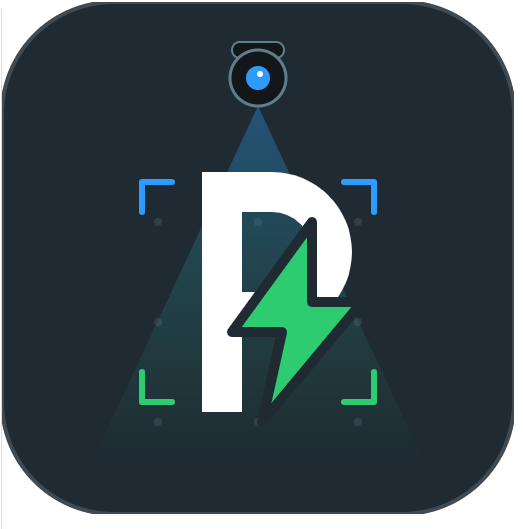
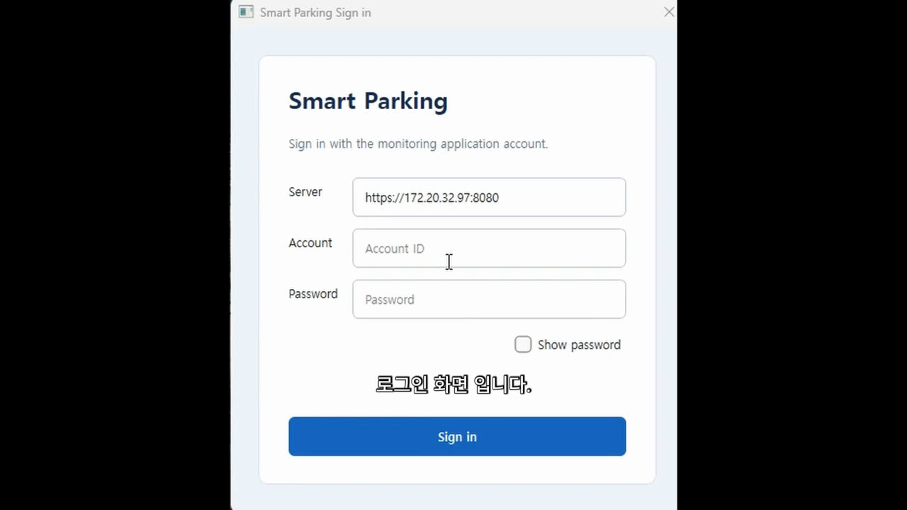
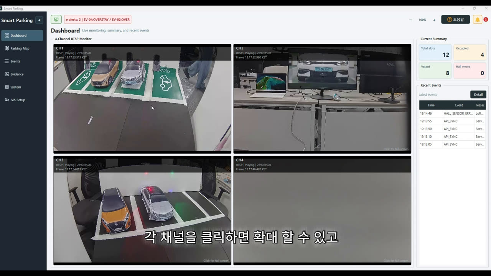
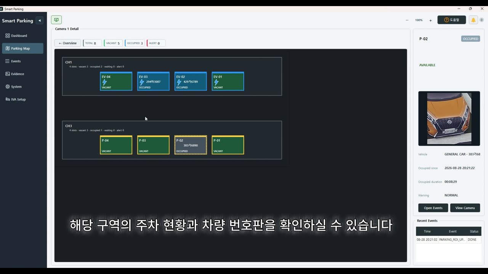
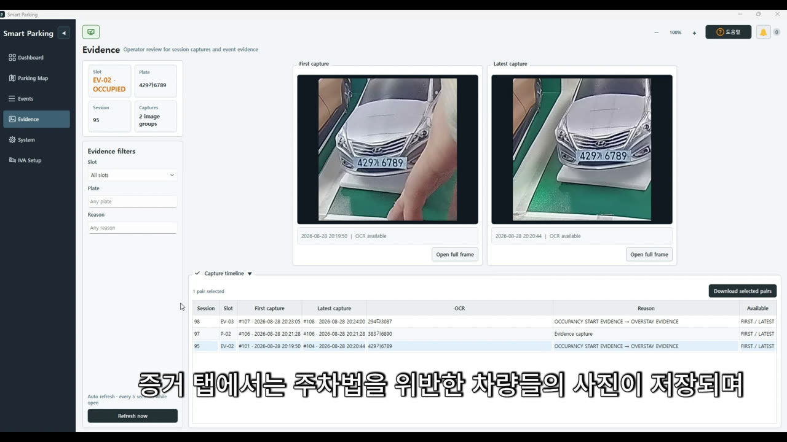
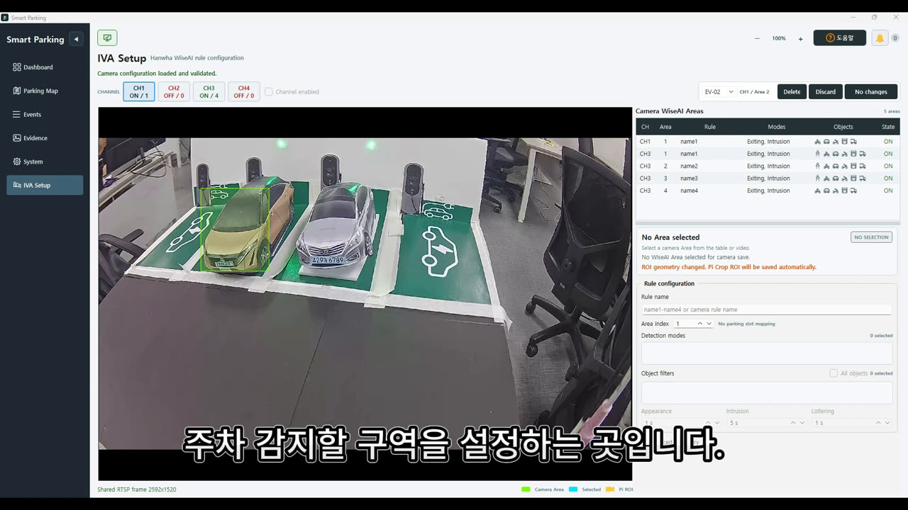
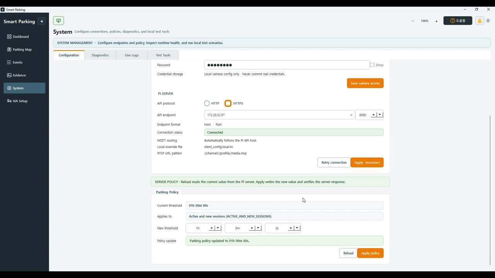
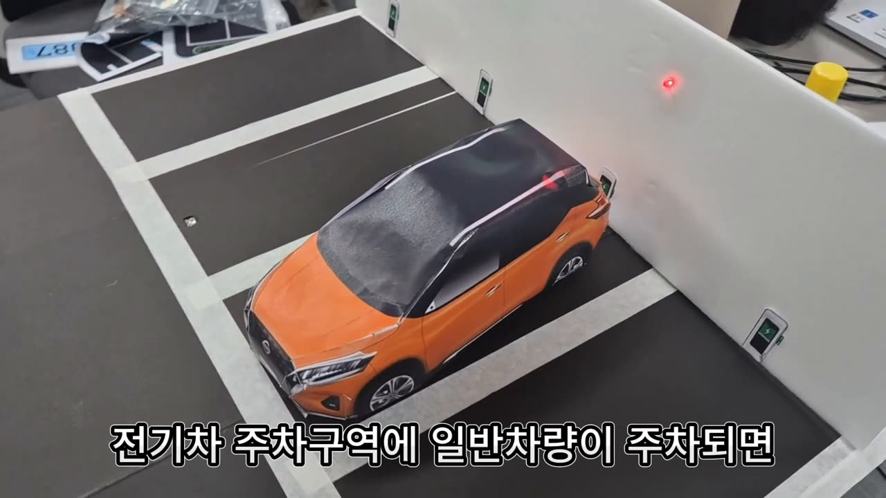

<p align="center">
  
</p>

<h1 align="center">EV Parking System</h1>

<p align="center">
  CCTV 기반 스마트 주차장 통합 관제 시스템 설계 및 구현 · 2026 졸업작품
</p>

<p align="center">
  
  
</p>

---

## 프로젝트 소개

한화비전(Hanwha Vision) CCTV와 STM32 센서 노드를 결합해, 주차면 점유·전기차(EV) 여부·화재를
실시간으로 감지하고 관제 요원이 Qt 클라이언트 하나로 확인·대응할 수 있게 하는 통합 주차 관제
시스템입니다.

- **감지** — STM32 홀 센서(점유)와 불꽃 센서(화재)가 LoRa로 Raspberry Pi 게이트웨이에 보고
- **인식** — Pi 서버가 카메라 Snapshot/RTSP 프레임을 OpenCV로 전처리하고 Gemini OCR로 번호판을
  판독해 EV / NON_EV / UNKNOWN을 판별, SQLite에 세션·이미지·이벤트로 기록
- **관제** — Qt 클라이언트가 4채널 RTSP 영상과 주차면 상태(점유 시간, 차량번호, 위반 여부)를
  표시하고, MQTT로 화재 후보 알림을 받아 즉시 경고

```text
STM32 (홀/불꽃 센서) → LoRa → Raspberry Pi 서버 (MQTT·Snapshot API·OpenCV·Gemini OCR·SQLite)
                                        ↓
                              Qt 관제 클라이언트 (RTSP 영상·주차 상태·화재 알림)
```

4개 하위 시스템(`Pi_Server`, `Qt_Client`, `STM`, `cv_snapshot_api`)을 하나의 저장소로
통합했습니다. 각 폴더는 원래 개별 저장소였으며, 현재는 이 저장소의 하위 디렉터리로 관리됩니다.

## 구성

- [`Pi_Server`](./Pi_Server) — Raspberry Pi 기반 C++ 서버 (MQTT, RTSP, Snapshot API, OpenCV, SQLite)
- [`Qt_Client`](./Qt_Client) — Qt/C++ 관제 클라이언트
- [`STM`](./STM) — STM32 펌웨어 (LED/Buzzer/지자기센서 연동)
- [`cv_snapshot_api`](./cv_snapshot_api) — OpenCV 기반 Snapshot/영상 처리 API

각 하위 폴더의 상세 내용은 폴더 내 README.md를 참고하세요.

> 이전 버전(v1.0, v2.0)의 릴리즈 노트와 스크린샷은
> [Releases](../../releases)에서 확인할 수 있습니다.

## v3.0 업데이트 내역

> 각 저장소의 `develop` 브랜치 최신 커밋(8/26 전후, Stage 3 "최종 통합 기능 구현")을
> 기준으로 정리한 내용입니다. 이 시점부터 `cv_snapshot_api`도 모노레포에 포함됩니다
> (8/21 최초 커밋 이후 생성됨 — 버전 기록은 아래 "cv_snapshot_api 릴리즈 노트" 참고).

v2.0 이후 인증·보안, 성능 최적화, 그리고 Qt 클라이언트 UI 전면 개편이 이루어진
최종 통합 단계입니다.

### Pi_Server

- **성능** — DB 연결 PRAGMA 미적용 버그 수정 및 폴링 쿼리 최적화로 유휴 CPU
  39.6% → 3.4%로 감소(EVDA-241, 11.6배)
- **카메라 인식 확장** — CH2 입구 차량 인식 + CH1·CH3 ONVIF IVA 기능 통합,
  `/dev/parking_alert` 커널 6.1 호환성 보완(EVDA-238/239)
- **보안** — TLS 설정 및 인증서 생성 도구 추가(EVDA-225)
- **진단/검증** — LoRa UART 진단 콘솔 C++ 전환, STM32 센서 링크 HIL(hardware-in-the-loop)
  승인 테스트(EVDA-223)
- **알림** — 텔레그램 알림 메시지 포맷 개선, MQTT 기반 무중단 화재 경보 해제 도구(EVDA-216)
- **데모 안정화** — 최종 데모 영상 촬영을 위해 `demo_0826` 브랜치에서 진행된 수정사항도
  반영: 카메라 이미지 서버 복구(fix), 등록 차량 DB 기반 번호판 fuzzy-매칭으로 OCR 한글
  오인식 보정, CH1(EV01~04)/CH3(P01~04) 최종 슬롯 체계로 통일(기존 `develop`에 남아있던
  `EV01~EV08` 단일 체계는 이 작업으로 대체됨 — Parking Map 화면의 실제 P-01~P-04 표시와
  일치)

### Qt_Client (UI 변화 큼 — 아래 스크린샷 참고)

- **로그인 화면 추가** — 앱 로그인 및 서버 Bearer 인증 경계 도입, 로그인 전에는
  RTSP·API·MQTT 연결을 시작하지 않음
- **Evidence 시간순 페어 타임라인** — 기존 개별 조회 방식을 캡처 페어 타임라인으로
  재구성, 자동 새로고침과 선택 다운로드 지원(EVDA-229)
- **탭 통폐합** — Image Compare 및 Parking ROI 탭 제거, Evidence/IVA Setup 화면으로
  기능 흡수(EVDA-230/233)
- **Dashboard 개편** — 공통 네비게이션·알림 UI, 모니터링 레이아웃 개선, 페이지
  타이틀/헤더 레이아웃 통일(EVDA-213)
- **Parking Map 개편** — 운영 UI 개선, 12카메라 전체 보기, 차량 검색 추가(EVDA-213)
- **Events / Debug 탭** UI 후속 정리(EVDA-228/234)
- **IVA Setup** — 편집 기능 보강, 미저장 변경 보호, 레이아웃 복구(EVDA-232)
- **데모 촬영용 UI 폴리시** — 최종 데모 영상 촬영을 위해 `codex/video-test` 브랜치에서
  진행된 작업도 반영: 앱 전체 폰트 크기 설정(신규), System 설정·주차 정책 UI 통합,
  Evidence/Parking Map 불필요 라벨 정리, Parking Policy threshold 입력 겹침 수정. 아래
  스크린샷은 이 브랜치의 UI를 캡처한 것입니다.

### STM

- **화재 감지 안정화** — 판정 기준을 적응형에서 DC 절대 임계로 단순화, FFT twiddle
  테이블 제거로 플래시 용량 59% 절감(EVDA-218/46)
- **LoRa 신뢰성** — 하트비트 30초 → 10초 단축 + 노드별 스태거(충돌 회피), 화재
  DETECTED 이벤트 2회 추가 재전송(EVDA-46/124)
- **구조 통합** — 중복돼 있던 `STM1/`+`STM2/` 프로젝트(428개 파일 복제)를 `STM/`
  하나로 합치고, `board_config.h` 한 줄로 보드를 선택하도록 변경

### 스크린샷

> 최종 데모 영상(팀 보관 Google Drive)에서 캡처한 v3.0 시점 화면입니다. v1.0 스크린샷과
> 비교하면 로그인 화면, Evidence 타임라인, IVA Setup 등 Qt 클라이언트 UI가 크게
> 달라진 것을 볼 수 있습니다.

| | |
|---|---|
|  로그인 화면 (신규) |  Dashboard — 4채널 RTSP 모니터링 |
|  Parking Map — 슬롯 상세/차량 정보 |  Evidence — 캡처 페어 타임라인 |
|  IVA Setup — WiseAI 영역 설정 |  System — 서버 연결/주차 정책 설정 |
|  EV 구역 내 일반차량 주차 감지(실물 데모) | |

## cv_snapshot_api 릴리즈 노트

> 원본 저장소(`cv_snapshot_api`)에는 별도 GitHub Release가 없고, 대신 저장소 내
> [`RELEASE_NOTES.md`](./cv_snapshot_api/RELEASE_NOTES.md)에 버전별 구현/검증 상태가 기록되어
> 있습니다. 그 내용을 그대로 옮겼습니다.

이 문서는 실제 구현과 검증 상태를 구분해 기록한다. 출시 버전에는 확인되지 않은 기능이나 외부 구성요소 연동을 포함하지 않는다.

### [refector] - 2026-08-24

`cv_snapshot_api_release`의 별도 소스 복사본이다. ROI와 입력 해상도는 바꾸지 않았다.

- OpenCV 내부 병렬 처리를 기본 1개 스레드로 제한한다.
- 무거운 Canny·환경 분석·이미지 세트 처리를 하나의 admission slot으로 직렬화하고, 기본
  2,500 ms 시작 간격을 둔다. 너무 이른 요청은 HTTP 429
  `PROCESSING_RATE_LIMITED`, 진행 중 요청은 HTTP 503 `PROCESSING_BUSY`를 반환한다.
- `GET /image/jpg`는 채널별 최근 처리 JPEG를 기본 2,500 ms 동안 반환한다. rate limit 또는
  busy 상태인데 이전 결과가 있으면 그 stale 결과를 반환해 polling이 새 캡처를 증폭시키지 않는다.
- 새 값은 `SampleComponent_default_attribute_0.json`의 `opencv_thread_limit`,
  `processing_min_interval_ms`, `processed_jpeg_cache_ttl_ms`로 조정한다.

CV5 Docker build, 새 CAP 생성, 카메라 runtime CPU·온도·watchdog 검증은 아직 수행하지 않았다.

### [0.1.0] - 2026-08-05

#### 기준선

CV5 OpenSDK용 현재 `cv_snapshot_api` 소스와 테스트 UI의 기능 기준선이다. 이 버전은 카메라 프레임을 캡처하고, 동일 프레임의 원본·자동 개선·지정 필터 JPEG를 제공한다.

#### 주요 기능

- SDK channel `0`부터 `3`까지 선택 가능한 채널 조회와 진단 흐름
- JPEG 조회 서버 시작 및 기존 `GET /image/jpg?channel={channel}` 호환 경로
- 동일 프레임 기준 원본, 자동 개선, 지정 OpenCV 필터 결과 생성
- 영상 기반 환경 판단과 자동 필터 선택
- `run_id`와 결과 ID 기반 JPEG 조회
- 활성 필터 catalog 조회 및 다중 필터 비교용 테스트 웹 UI
- 파일 로그 조회·삭제와 4채널 순차 진단 UI

#### 운영 API

| Method | Endpoint | 역할 |
|---|---|---|
| POST | `/opensdk/{app_id}/startserver` | JPEG 조회 TCP HTTP 서버 시작 |
| GET | `/opensdk/{app_id}/channels` | 지원 채널과 기본 채널 조회 |
| GET | `/opensdk/{app_id}/filters` | 직접 요청 가능한 처리 필터 조회 |
| POST | `/opensdk/{app_id}/images/generate` | 한 프레임의 원본·개선·지정 필터 결과 생성 |
| GET | `http://{camera-ip}:{port}/images/result/jpg?run_id={run_id}&result={id}` | 생성 JPEG 조회 |

상세 요청·응답과 오류 계약은 [`cv_snapshot_api/docs/server-api-integration.md`](./cv_snapshot_api/docs/server-api-integration.md)를 따른다.

#### 제공 필터

| 필터 ID | 대응 환경 |
|---|---|
| `bilateral_d5` | `sensor_noise` |
| `stretch_1_99` | `low_contrast` |
| `fast_bilateral` | `extreme_low_light` |
| `bilateral_gamma_clahe` | `ir_night` |
| `backlight_combined` | `backlight` |

#### 알려진 제한사항

- 환경 판단은 입력 JPEG의 영상 특징 기반 추정이며, Day/Night 모드, IR LED 상태, IR-cut filter 상태와 센서 흑백 모드는 조회하지 못한다.
- 동시에 하나의 이미지 생성 요청만 처리하며, 겹친 요청은 `PROCESSING_BUSY`가 될 수 있다.
- 결과 JPEG는 최근 8개 `run_id`만 메모리에 보관한다. 앱 재시작 시 삭제되며 영구 저장되지 않는다.
- `auto_filter` 또는 `applied_filter`가 `none`이면 검증된 개선 처리를 적용하지 않은 원본 내용 JPEG를 뜻한다.
- 인증, HTTPS, 외부 접근 제한과 장기 로그 보존은 범위에 포함되지 않는다.

#### 검증 상태

| 항목 | 상태 | 근거 및 경계 |
|---|---|---|
| 운영 API route·요청·응답 계약 | 정적 확인 | 현재 C++ source와 서버 연동 문서 대조 |
| OpenCV/필터 catalog·이미지 결과 cache | 정적 확인 | source 기준, 최신 CAP 재검증 필요 |
| 테스트 웹 UI·로그 UI | 정적 확인 | source 기준, 최신 CAP 설치 후 재확인 필요 |
| 과거 묶음 CAP의 이미지·로그 기본 흐름 | 카메라 확인 기록 있음 | 이후 이미지 세트·UI 변경분을 포함한 최신 CAP 증거는 별도 필요 |
| 현재 source의 CV5 Docker 빌드 | 미검증 | 이 기준선에 대해 새 build 필요 |
| 현재 source의 CAP 생성·설치 | 미검증 | 이 기준선에 대해 새 CAP 필요 |
| 현재 source의 카메라 4채널·이미지 세트 런타임 | 미검증 | 최신 CAP 설치 후 확인 필요 |
| 서버 OCR·STM LED 연동 | 미구현 | `0.2.0` 이후 범위 |

#### 호환성

- 위 운영 API의 기존 method와 path를 유지한다.
- `run_id`는 카메라가 생성하며, 서버가 미리 생성하거나 추측하지 않는다.
- 레퍼런스 프로젝트 `snapshot_jpeg`, `display_image_opencv`는 변경하지 않았다.

### 다음 버전

`0.2.0`은 저조도 OCR 재촬영 지원을 위한 카메라 메타데이터 확장과 서버·STM 연동 검증을 대상으로 한다. 아직 구현 또는 릴리즈 항목으로 확정하지 않는다. 세부 계획은 [`cv_snapshot_api/docs/implementation-plan.adoc`](./cv_snapshot_api/docs/implementation-plan.adoc)에 기록한다.
